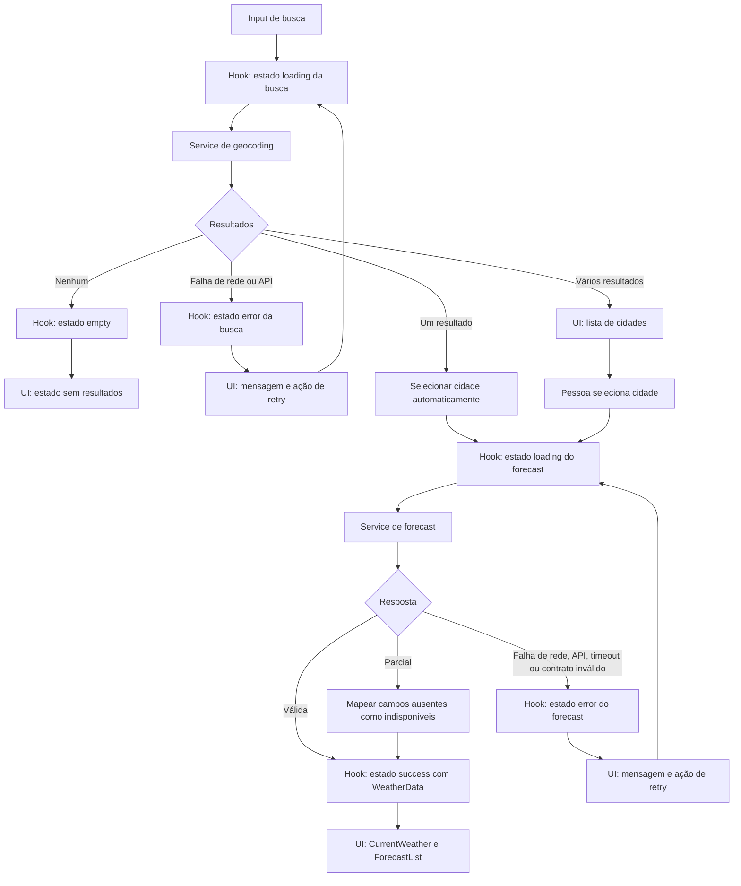

# Plano Técnico — Weather App

## Architecture

Aplicação web SPA, renderizada no cliente, organizada em quatro camadas pequenas:

1. **Interface (`components/`, `App.tsx`)**: busca, seleção de cidade, alternância de unidade e apresentação dos estados de tela.
2. **Orquestração (`hooks/`)**: coordena busca, seleção, consulta meteorológica, retry e estado de carregamento.
3. **Serviços (`services/`)**: chamadas HTTP ao Open-Meteo, timeout e transformação da resposta externa para o modelo interno.
4. **Domínio (`types/`, `lib/`)**: contratos compartilhados e funções puras de conversão, formatação e interpretação de códigos meteorológicos.

Não haverá backend, autenticação, banco de dados, cache offline, persistência de preferências ou atualização periódica. As requisições ao Open-Meteo partem do navegador. A interface mantém o fluxo simples: busca enviada pelo formulário; seleção automática quando houver um único resultado; seleção manual quando houver mais de um.

## Tech Stack

- **Linguagem:** TypeScript em modo strict.
- **UI e build:** React 19 e Vite, conforme dependências existentes.
- **Estilo:** Tailwind CSS, seguindo o tema e os componentes já presentes no projeto.
- **Testes:** Vitest, Testing Library e Playwright.
- **Lint e formatação:** Biome.
- **Gerenciador:** pnpm; Node.js 22 ou superior.
- **Dependências de runtime:** manter somente React e React DOM; não adicionar biblioteca de estado, cliente HTTP ou validação de schema sem necessidade demonstrada.

## Project Structure

Manter a estrutura atual e colocar cada responsabilidade em seu diretório existente:

- `src/App.tsx`: compõe a experiência e seleciona qual estado de tela apresentar.
- `src/components/SearchBar.tsx`: formulário manual de cidade; sem sugestões enquanto digita.
- `src/components/CityResults.tsx`: lista de até cinco cidades quando a busca retorna múltiplos resultados; cada item permite seleção explícita.
- `src/components/CurrentWeather.tsx`, `ForecastList.tsx`, `ForecastCard.tsx`, `UnitToggle.tsx`: apresentação dos dados e controles.
- `src/components/states/`: estados inicial, carregamento, vazio e erro.
- `src/hooks/useWeather.ts`: fluxo de busca, seleção, consulta e nova tentativa; descarta respostas obsoletas.
- `src/services/weatherService.ts`: contratos HTTP, normalização da resposta, timeout e erros de serviço.
- `src/types/weather.ts`: tipos de domínio e estados do fluxo.
- `src/lib/temperature.ts`: conversão e arredondamento de temperatura.
- `src/lib/format.ts`: datas em pt-BR e referência temporal com fuso.
- `src/lib/weatherCodes.ts`: mapeamento dos códigos WMO para descrições em pt-BR e fallback para código desconhecido.
- `tests/unit/`: funções puras, serviço e componentes/hook.
- `tests/e2e/weather.spec.ts`: fluxos críticos de ponta a ponta.

Não criar novas camadas ou diretórios antes de surgir uma necessidade não atendida pela estrutura acima.

## Data Model

Os tipos abaixo são contratos de domínio planejados, não código final. Valores opcionais ou ausentes são representados por `null`, nunca convertidos silenciosamente em zero.

```ts
type TemperatureUnit = 'celsius' | 'fahrenheit';

type WeatherValue<T> = T | null;

interface City {
  id: number;
  name: string;
  country: string | null;
  region: string | null;
  latitude: number;
  longitude: number;
}

interface CurrentWeather {
  temperatureC: WeatherValue<number>;
  weatherCode: WeatherValue<number>;
  humidityPercent: WeatherValue<number>;
  windSpeedKmh: WeatherValue<number>;
  pressureHpa: WeatherValue<number>;
  precipitationMm: WeatherValue<number>;
  observedAtLocal: string | null;
}

interface ForecastDay {
  date: string; // YYYY-MM-DD no fuso local da cidade
  weatherCode: WeatherValue<number>;
  minTemperatureC: WeatherValue<number>;
  maxTemperatureC: WeatherValue<number>;
  precipitationProbabilityMaxPercent: WeatherValue<number>;
}

interface WeatherData {
  city: City;
  current: CurrentWeather;
  forecast: ForecastDay[]; // cinco posições de calendário, inclusive posições indisponíveis
  timezone: string | null; // fuso IANA retornado pelo endpoint
  utcOffsetSeconds: number | null; // deslocamento UTC retornado pelo endpoint
  receivedAt: string; // instante ISO UTC usado para avaliar a idade da observação
}
```

Invariantes:

- Temperaturas permanecem em Celsius no modelo interno; a unidade escolhida só altera apresentação.
- `forecast` mantém cinco posições ordenadas por data local; se o provedor não retornar uma data ou métrica, a posição/campo permanece e recebe `null`.
- A descrição do tempo é derivada de `weatherCode` pela tabela de interpretação WMO; códigos não mapeados usam “Condição desconhecida”.
- `observedAtLocal` vem de `current.time`; `timezone` e `utcOffsetSeconds` vêm da raiz da resposta meteorológica. Um campo ausente não deve ser inventado; a atualidade fica não confirmada quando faltarem os dados necessários.

## Data Flow

1. A pessoa envia um termo não vazio pelo formulário. A camada de domínio remove espaços externos, normaliza caracteres acentuados e caixa para a consulta, e preserva pontuação válida.
2. O serviço de geocoding solicita até cinco resultados. Zero resultados produzem estado vazio; um resultado é selecionado automaticamente; de dois a cinco, `CityResults` apresenta opções e aguarda a seleção explícita por `selectCity`.
3. A seleção fornece a identidade e as coordenadas da cidade ao serviço de previsão. A consulta inclui condições atuais, dados diários para hoje e os quatro dias seguintes e fuso `auto`.
4. O serviço valida o envelope da resposta e mapeia nomes/campos externos para os tipos de domínio. Métricas ausentes ficam `null`; resposta de topo inválida é erro recuperável.
5. A interface apresenta cidade, dados atuais, referência temporal e exatamente cinco posições de previsão. Datas seguem o fuso local da cidade.
6. A alternância C/F aplica a fórmula definida na spec e arredonda para inteiro mais próximo, com empates afastados de zero; não dispara nova consulta HTTP.
7. O hook associa cada resposta à consulta/cidade que a originou. Resposta de requisição anterior não pode substituir os dados da seleção mais recente.



## External APIs

### Open-Meteo Geocoding

- **URL base:** `https://geocoding-api.open-meteo.com/v1/search`.
- **Método:** `GET`.
- **Parâmetros relevantes:** `name` é o termo normalizado; `count=5` limita os resultados; `language=pt` solicita nomes/localização em português; `format=json` solicita JSON. Os parâmetros `current`, `daily` e `timezone` não se aplicam a este endpoint.
- **Exemplo de URL:** `https://geocoding-api.open-meteo.com/v1/search?name=lisboa&count=5&language=pt&format=json`.
- **Exemplo resumido de resposta** (valores ilustrativos):

```json
{
  "results": [
    {
      "id": 123456,
      "name": "Lisboa",
      "latitude": 38.7223,
      "longitude": -9.1393,
      "country_code": "PT",
      "country": "Portugal",
      "admin1": "Lisboa"
    }
  ]
}
```

- **Mapeamento para `City`:** `id` → `id`; `name` → `name`; `country` → `country`; `admin1` → `region`; `latitude` → `latitude`; `longitude` → `longitude`. `country` e `admin1` ausentes viram `null`; não inferir país ou região. Ignorar campos sem uso no modelo, como `country_code`.
- Uma resposta válida sem `results` ou com lista vazia representa busca sem resultados. HTTP não bem-sucedido, rede, JSON inválido ou timeout representam erro de busca, nunca “cidade não encontrada”.

### Open-Meteo Forecast

- **URL base:** `https://api.open-meteo.com/v1/forecast`.
- **Método:** `GET`.
- **Parâmetros relevantes:** `latitude` e `longitude` da cidade selecionada; `current=temperature_2m,relative_humidity_2m,wind_speed_10m,surface_pressure,precipitation,weather_code`; `daily=weather_code,temperature_2m_max,temperature_2m_min,precipitation_probability_max`; `forecast_days=5`; `timezone=auto`; `temperature_unit=celsius`; `wind_speed_unit=kmh`; `precipitation_unit=mm`. `current` e `daily` definem os campos retornados; `timezone` faz as datas diárias seguirem o fuso da cidade.
- **Exemplo de URL:**

```text
https://api.open-meteo.com/v1/forecast?latitude=38.7223&longitude=-9.1393&current=temperature_2m,relative_humidity_2m,wind_speed_10m,surface_pressure,precipitation,weather_code&daily=weather_code,temperature_2m_max,temperature_2m_min,precipitation_probability_max&forecast_days=5&timezone=auto&temperature_unit=celsius&wind_speed_unit=kmh&precipitation_unit=mm
```

- **Exemplo resumido de resposta** (arrays reduzidos a cinco dias; valores ilustrativos):

```json
{
  "latitude": 38.72,
  "longitude": -9.14,
  "utc_offset_seconds": 0,
  "timezone": "Europe/Lisbon",
  "timezone_abbreviation": "WET",
  "current_units": {
    "time": "iso8601",
    "temperature_2m": "°C",
    "relative_humidity_2m": "%",
    "wind_speed_10m": "km/h",
    "surface_pressure": "hPa",
    "precipitation": "mm",
    "weather_code": "wmo code"
  },
  "current": {
    "time": "2026-11-05T10:00",
    "temperature_2m": 18.4,
    "relative_humidity_2m": 72,
    "wind_speed_10m": 11.5,
    "surface_pressure": 1013.2,
    "precipitation": 0,
    "weather_code": 2
  },
  "daily_units": {
    "time": "iso8601",
    "weather_code": "wmo code",
    "temperature_2m_max": "°C",
    "temperature_2m_min": "°C",
    "precipitation_probability_max": "%"
  },
  "daily": {
    "time": ["2026-11-05", "2026-11-06", "2026-11-07", "2026-11-08", "2026-11-09"],
    "weather_code": [2, 3, 61, 3, 0],
    "temperature_2m_max": [19.1, 18.4, 17.2, 18.0, 20.1],
    "temperature_2m_min": [13.2, 12.8, 12.1, 11.9, 12.5],
    "precipitation_probability_max": [10, 20, null, 45, 5]
  }
}
```

- **Mapeamento para `WeatherData`:**
  - `city` é o `City` selecionado; `receivedAt` é criado pelo cliente no recebimento da resposta, em ISO UTC.
  - `current.temperature_2m` → `current.temperatureC`; `weather_code` → `current.weatherCode`; `relative_humidity_2m` → `current.humidityPercent`; `wind_speed_10m` → `current.windSpeedKmh`; `surface_pressure` → `current.pressureHpa`; `precipitation` → `current.precipitationMm`; `current.time` → `current.observedAtLocal`.
  - A raiz `timezone` e `utc_offset_seconds` → `WeatherData.timezone` e `WeatherData.utcOffsetSeconds`, respectivamente. Não usar `timezone_abbreviation` como substituto do deslocamento UTC.
  - Para cada índice `i` de `daily.time`, criar `forecast[i]`: `time[i]` → `date`; `weather_code[i]` → `weatherCode`; `temperature_2m_min[i]` → `minTemperatureC`; `temperature_2m_max[i]` → `maxTemperatureC`; `precipitation_probability_max[i]` → `precipitationProbabilityMaxPercent`. Arrays são paralelos e devem ser lidos pelo mesmo índice, não por posição após filtragem.
  - `null` ou campo ausente em uma métrica → `null` no modelo; não converter ausência em zero. Manter cinco posições. Se a resposta diária não fornecer uma data, construir a data esperada no fuso da cidade para essa posição e deixar as métricas indisponíveis; se o envelope `current` ou `daily` inteiro estiver ausente, tratar como erro recuperável.
- **Unidades:** temperatura °C, umidade %, velocidade do vento km/h, pressão hPa, precipitação atual mm e probabilidade máxima diária de precipitação %. Validar as unidades retornadas (`current_units`/`daily_units`) antes do mapeamento.
- **Limite de espera:** 10 segundos por requisição. Não há retry automático; a pessoa pode acionar retry, que repete a mesma operação com o mesmo termo ou cidade.
- **Contrato externo:** não usar chave de API. Confirmar termos, atribuição, cobertura e limites de chamadas antes de lançamento público; essa validação é gate de release.

## State Management

Usar estado local do React, sem Redux, Context global ou persistência. `useWeather` controla o fluxo assíncrono e seus dados; `App` mantém somente a unidade C/F, que inicia em Celsius. A unidade é enviada como prop aos componentes e os valores convertidos são derivados durante a renderização, nunca armazenados como uma segunda cópia do clima.

Os únicos estados explícitos do fluxo são `idle`, `loading`, `success`, `error` e `empty`. `operation` diferencia busca de cidade e consulta meteorológica sem criar status adicionais. Em `success` de busca, a lista de cidades fica disponível enquanto a pessoa escolhe; em `success` meteorológico, o estado contém `WeatherData`.

Contrato conceitual:

```ts
type Operation = 'search' | 'weather';

type WeatherState =
  | { status: 'idle' }
  | {
      status: 'loading';
      operation: 'search';
      query: string;
    }
  | {
      status: 'loading';
      operation: 'weather';
      city: City;
    }
  | {
      status: 'success';
      operation: 'search';
      query: string;
      cities: City[]; // dois ou mais resultados aguardando seleção
    }
  | { status: 'success'; operation: 'weather'; data: WeatherData }
  | { status: 'empty'; query: string }
  | {
      status: 'error';
      operation: 'search';
      message: string;
      retryQuery: string;
    }
  | {
      status: 'error';
      operation: 'weather';
      message: string;
      retryCity: City;
    };
```

- Busca vazia não inicia requisição.
- Para zero resultados, transicionar a busca para `empty`; para um único resultado, iniciar `loading` meteorológico automaticamente; para vários, transicionar a `success` de busca e manter os resultados em `CityResults` até a seleção.
- `retry` reexecuta a operação discriminada pelo estado de erro, preservando `retryQuery` para busca ou `retryCity` para consulta meteorológica.
- Converter temperaturas durante a renderização a partir de Celsius: $°F = (°C × 9/5) + 32$ e $°C = (°F − 32) × 5/9$. Arredondar para inteiro mais próximo, com empates afastados de zero. Alternar a unidade atualiza apenas o estado de apresentação e não dispara request.
- Preferência de unidade não persiste entre recargas na v1.

## Error Handling

- **Rede:** falha de `fetch` vira `error` com mensagem de conexão e retry manual da mesma operação.
- **HTTP/API:** resposta HTTP não bem-sucedida vira `error`; manter `operation` e contexto de retry. Falhas do provedor nunca são tratadas como resposta vazia.
- **Timeout:** cada chamada é abortada aos 10 segundos e transiciona para `error`; a mensagem explica que demorou demais e permite retry manual. Não há retry automático.
- **JSON/contrato inválido:** falha de parse ou ausência do envelope `current` ou `daily` transiciona para `error` meteorológico recuperável; uma busca sem `results` ou com `results: []` é `empty`, não erro.
- **Resposta parcial:** métrica ou valor diário individual ausente/null vira `null` e é apresentado como indisponível, preservando os demais campos e as cinco datas. Não substituir campo ausente por zero. Se a data diária faltar, preencher a posição esperada no fuso local e manter as métricas dela indisponíveis.
- **Referência temporal:** calcular idade usando `receivedAt`, `observedAtLocal` e `utcOffsetSeconds`. Acima de 60 minutos, identificar como desatualizado; se faltar horário, fuso ou deslocamento, marcar atualidade como não confirmada, sem inventar referência.
- **Concorrência:** ao iniciar nova busca/seleção, abortar a chamada anterior quando possível e associar cada resultado à operação que o iniciou; ignorar respostas obsoletas para que não substituam a cidade mais recente.
- Mensagens destinadas à pessoa não expõem stack trace, URLs com coordenadas ou detalhes internos.

## Testing Strategy

Derivar os testes da matriz de rastreabilidade na spec e nomeá-los com os IDs RF/US sempre que possível.

- **Unitários:** normalização preservando pontuação; conversão C/F e casos de empate; arredondamento; formatação de datas; idade/fuso; mapeamento de todos os códigos WMO suportados e código desconhecido.
- **Serviço:** parâmetros e mapeamento de ambas as APIs; zero resultados; resposta parcial com `null`; HTTP inválido; JSON inválido; timeout de 10 s; garantir que temperatura não é convertida no serviço.
- **Componentes/hook:** transições idle/loading/success/error/empty por operação; busca vazia, resultado único automático, múltiplos resultados em `success` de busca, retry preservando contexto; troca C/F não faz novo request; resposta obsoleta não substitui a cidade atual.
- **E2E:** busca vazia, zero/um/vários resultados, consulta atual e cinco dias, troca C/F, falha e retry; repetir fluxos essenciais nos viewports definidos em RNF1 e navegadores de RNF7.
- **Usabilidade:** conduzir teste moderado com pelo menos cinco participantes representando as personas; pelo menos quatro devem localizar uma cidade e identificar as condições atuais em até 30 segundos, e pelo menos quatro devem identificar os cinco dias e alternar a unidade em até 60 segundos, sem ajuda, conforme RNF2.
- **Acessibilidade:** análise automatizada nos fluxos principais e verificação manual de teclado, foco e leitor de tela conforme RNF5.
- **Metas operacionais:** medir os percentis de RNF4 sob o perfil de rede definido; executar verificações sintéticas de RNF6 a cada cinco minutos. Testes automatizados não devem depender de chamadas reais não determinísticas; usar fixtures para unitários/E2E e manter a verificação sintética separada.
- **Gate do projeto:** `pnpm lint`, `pnpm build`, `pnpm test` e, para a cobertura E2E, `pnpm test:e2e`.

## Risks & Trade-offs

- **Dependência direta do Open-Meteo:** reduz infraestrutura e dispensa chave, mas limita disponibilidade, latência, cobertura e termos ao provedor. Mitigar com timeout, tratamento de erro, monitoramento e gate de lançamento; não adicionar proxy/cache sem necessidade comprovada.
- **Normalização de busca:** remover diacríticos melhora a busca conforme a spec, mas não garante resultados para todos os topônimos. Preservar a pontuação, apresentar o nome oficial retornado e permitir nova busca.
- **Seleção automática de um único resultado:** reduz passos no caso inequívoco; resultados múltiplos exigem escolha para evitar previsão do local errado.
- **Sem persistência ou offline:** mantém privacidade e simplicidade, mas preferências e dados não sobrevivem à recarga nem ficam disponíveis sem rede.
- **Corte de atualidade de 60 minutos:** torna o estado testável, mas pode marcar como desatualizada uma observação que o provedor ainda considera útil. Manter o horário visível e sinalizar em vez de ocultar os dados.
- **Conformidade WCAG e matriz de navegadores:** aumentam o esforço de validação; limitar os testes à matriz e fluxos definidos na spec, sem prometer compatibilidade fora dela.
